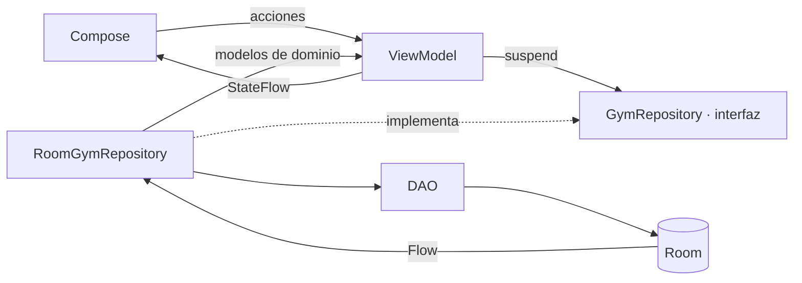
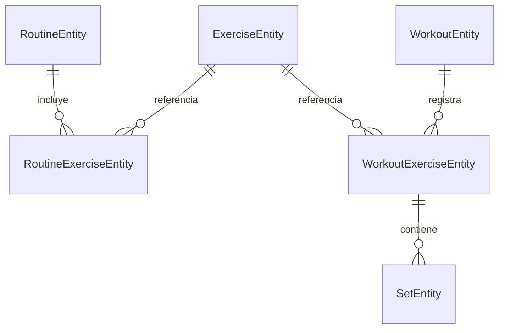

# Heavy Duty · Diario de entrenamiento

Proyecto académico Android escrito en **Kotlin + Jetpack Compose**, con **MVVM**, flujo unidireccional de datos y persistencia **Room**. La interfaz usa una identidad propia: fondo oscuro, verde lima y contenido en español.

## 1. Estructura de paquetes

Se conserva el namespace de la plantilla para abrir el proyecto sin cambiar su identidad. Puedes renombrarlo desde Android Studio antes de publicarlo.

```text
app/
├── build.gradle.kts
├── schemas/                         # Esquema Room versionado, generado por KSP
└── src/
    ├── main/
    │   ├── AndroidManifest.xml
    │   └── java/com/example/myapplication/
    │       ├── MainActivity.kt
    │       ├── HeavyDutyApplication.kt   # Contenedor e inyección por constructor
    │       ├── data/
    │       │   ├── local/
    │       │   │   ├── GymDatabase.kt
    │       │   │   ├── SeedData.kt
    │       │   │   ├── dao/GymDao.kt
    │       │   │   └── entities/Entities.kt
    │       │   └── repository/RoomGymRepository.kt
    │       ├── domain/
    │       │   ├── model/Models.kt
    │       │   ├── repository/GymRepository.kt
    │       │   └── usecase/WorkoutStats.kt
    │       ├── viewmodel/
    │       │   ├── GymViewModels.kt
    │       │   └── ViewModelFactories.kt
    │       ├── ui/
    │       │   ├── HeavyDutyApp.kt       # Navigation Compose
    │       │   ├── screens/             # Inicio, catálogo, rutinas, sesión, progreso, perfil y cámara
    │       │   ├── components/          # Gráfica, tarjetas, permisos y diálogos
    │       │   └── theme/
    │       └── utils/                   # PhotoStore, LocationClient y formatos
    │
    └── test/java/com/example/myapplication/
        ├── WorkoutStatsTest.kt
        ├── RoomGymRepositoryTest.kt
        └── WorkoutFlowUiTest.kt
```

## 2. Gradle y dependencias

El archivo listo para usar está en [app/build.gradle.kts](app/build.gradle.kts). Sus aliases se definen en [gradle/libs.versions.toml](gradle/libs.versions.toml); el plugin KSP también se declara en el Gradle raíz.

| Componente | Versión fijada / configuración |
| --- | --- |
| AGP / Gradle | 9.4.1 / 9.6.0 (plantilla existente) |
| Kotlin / plugin Compose | 2.2.10 |
| SDK | compile/target 37, mínimo 24 |
| Java bytecode | 17 + desugaring de java.time |
| Compose BOM | 2026.02.01 |
| Material 3 / UI / Foundation | Administrados por el BOM |
| Activity Compose | 1.12.4 |
| Lifecycle / ViewModel Compose | 2.10.0 |
| Navigation Compose | 2.9.7 |
| Room / KSP | 2.8.4 / 2.3.6 |
| CameraX camera2, lifecycle, view | 1.5.3 |
| Play Services Location | 21.3.0 |
| Coroutines Android / Play Services | 1.10.2 |
| Coil / ExifInterface | 2.7.0 / 1.4.2 |
| JUnit / Robolectric | 4.13.2 / 4.17 |

Las versiones están fijadas para reproducibilidad; no se presentan como las versiones más recientes. AGP 9 incluye Kotlin: **no añadas además el plugin `org.jetbrains.kotlin.android`**. Consulta la [documentación oficial de Kotlin integrado](https://developer.android.com/build/migrate-to-built-in-kotlin).

No se necesita Firebase, una API key, Hilt ni un servidor para esta entrega.

## 3. Arquitectura



- **data** contiene Room y las conversiones entre entidades y modelos.
- **domain** contiene modelos Kotlin, el contrato del repositorio y las reglas de validación y cálculo. No importa Compose ni Room.
- **viewmodel** transforma flujos en StateFlow, conserva filtros y borradores con SavedStateHandle y procesa acciones en coroutines.
- **ui** presenta el estado con `collectAsStateWithLifecycle()` y envía acciones; no consulta el DAO.
- **utils** adapta las APIs de Android para fotos y ubicación.
- **AppContainer** crea dependencias y las entrega por constructor. Las factories permiten a Android recrear los ViewModels.

Es una arquitectura por capas en un único módulo Gradle, adecuada para el proyecto académico. Al crecer, se puede dividir el repositorio por funcionalidad y separar módulos sin cambiar los contratos de UI.

El diseño sigue las [recomendaciones de arquitectura de Android](https://developer.android.com/topic/architecture/recommendations). La capa de dominio se usa para las reglas compartidas, sin crear casos de uso que solo reenvíen cada llamada.

## 4. Paso a paso para estudiar y construir

### Paso 1 · Modelo y relaciones

Lee `domain/model/Models.kt` y `data/local/entities/Entities.kt`.



Una **rutina** es una plantilla. Un **workout** es una sesión concreta y almacena una copia del nombre y la selección de ejercicios. No depende de la rutina original para mostrar su historial. Esto evita perder sesiones cuando se modifica o elimina una rutina.

Cada serie pertenece a un ejercicio de una sesión, con peso, repeticiones, posición y estado completado. Las claves foráneas eliminan las series cuando se elimina su sesión. Las mediciones, fotos y gimnasios tienen tablas propias.

### Paso 2 · Base local y catálogo

Lee `GymDatabase.kt`, `GymDao.kt` y `SeedData.kt`.

- Se cargan **36 ejercicios**, repartidos entre pecho, espalda, pierna, hombro, brazos y core.
- Las instrucciones y el equipo de cada ejercicio están disponibles sin conexión.
- Se incluyen tres plantillas editables: Empuje, Tirón y Pierna y core.
- La siembra es transaccional e idempotente; no vuelve a crear las rutinas que el usuario haya eliminado.
- `@Transaction` mantiene coherencia al leer relaciones anidadas.
- El esquema se exporta en `app/schemas`. Una futura versión debe añadir una migración: no se usa borrado destructivo como solución a cambios de esquema.

### Paso 3 · Repositorio y reglas

Lee `RoomGymRepository.kt` y `WorkoutStats.kt`.

Las escrituras de una rutina y el inicio/finalización de una sesión son transacciones. Pulsar iniciar dos veces reutiliza la sesión activa. Una sesión finalizada ya no admite cambios en sus series.

El cálculo principal es:

```kotlin
val volume = completedSets.sumOf { it.weightKg * it.reps }
```

El volumen es carga externa, en kg × repeticiones. Con 0 kg de carga externa se registran las repeticiones, pero el volumen externo sigue siendo 0. El máximo es el mayor peso de una serie completada, **no** una estimación de 1RM.

Los valores deben ser finitos. Una serie admite 0–2000 kg y 1–1000 repeticiones. Para finalizar una sesión se necesita al menos una serie completada.

### Paso 4 · Estado y ciclo de vida

Lee `GymViewModels.kt` y `ViewModelFactories.kt`.

Hay ViewModels para la inicialización, catálogo, rutinas, entrenamiento, progreso y perfil. Los datos persistentes vienen de Room; SavedStateHandle conserva los filtros y el borrador de rutina.

```kotlin
val history = repository.history()
    .stateIn(viewModelScope, SharingStarted.WhileSubscribed(5000), emptyList())
```

La implementación comparte un helper con manejo de errores. La UI observa:

```kotlin
val history by model.history.collectAsStateWithLifecycle()
```

Las acciones de escritura usan una cola serializada en el ViewModel. Así se procesan las ediciones antes de finalizar una sesión. Los errores aparecen en Snackbar y no cierran el flujo silenciosamente.

### Paso 5 · Catálogo y rutinas

Lee `CatalogScreen.kt` y `RoutinesScreen.kt`.

1. El catálogo combina búsqueda y filtro muscular; normaliza acentos y mayúsculas.
2. Tocar un ejercicio abre sus instrucciones.
3. En Entrenar, se pueden crear, editar y eliminar rutinas.
4. El editor permite seleccionar y ordenar ejercicios y configurar series y repeticiones.
5. Al iniciar, se crea una sesión independiente; una sesión ya abierta se puede continuar desde Inicio o Entrenar.

### Paso 6 · Entrenar

Lee `WorkoutScreen.kt`.

1. Introduce kg y repeticiones. Los números válidos se persisten durante la edición.
2. Marca la casilla para completar una serie; se inicia un descanso de 90 segundos.
3. Para corregir una serie completada, desmarca primero la casilla.
4. Puedes añadir series y ejercicios, consultar la mejor serie de la sesión anterior y guardar la ubicación.
5. Al volver atrás la sesión sigue abierta. Al finalizar se guarda en el historial.
6. Descartar pide confirmación y elimina esa sesión.

Solo las series completadas cuentan para las estadísticas. Los campos vacíos o inválidos son borradores de UI; no sobrescriben el último número válido en Room.

El temporizador usa una fecha límite para tolerar pausas y rotación. Es un contador dentro de la app, sin alarma ni servicio de notificaciones en segundo plano.

### Paso 7 · Historial, gráficas y mediciones

Lee `ProgressScreen.kt`, `ProfileScreen.kt` y `components/Components.kt`.

- Historial con fecha, volumen, duración, series y notas.
- Detalle de cada sesión y eliminación con confirmación.
- Gráfica de volumen de todas las sesiones o de un ejercicio.
- Gráfica de peso máximo por ejercicio, con mejor marca.
- Las gráficas muestran los últimos 12 registros, con una descripción accesible de sus valores; los puntos representan sesiones, no días vacíos.
- Mediciones de peso corporal y cintura opcional. El perfil muestra las cinco mediciones recientes y una gráfica de las últimas 12.
- No se generan entrenamientos ficticios para llenar la gráfica.

### Paso 8 · Cámara y fotos

Lee `CameraScreen.kt`, `PermissionAction.kt` y `PhotoStore.kt`.

- CameraX abre la vista previa ligada al ciclo de vida y permite cambiar de cámara.
- Se solicita CAMERA con el launcher oficial de ActivityResult.
- La galería usa Android Photo Picker: no requiere permisos generales de almacenamiento.
- La app copia y recomprime las imágenes al directorio privado `files/progress`, corrige su orientación y no conserva sus metadatos GPS.
- Las fotos se ven en el perfil y pueden eliminarse. La más reciente ilustra la tarjeta del perfil.
- Una captura temporal se elimina después de importarla.
- No se usan enlaces temporales de la galería como almacenamiento definitivo.

La aplicación no requiere cámara para instalarse; la galería sigue disponible. Consulta [Photo Picker](https://developer.android.com/training/data-storage/shared/photopicker) y [CameraX](https://developer.android.com/media/camera/camerax).

### Paso 9 · Ubicación y permisos

Lee `LocationClient.kt` y `PermissionAction.kt`.

- Usa FusedLocationProviderClient con `getCurrentLocation()`.
- Pide acceso solo al pulsar guardar ubicación.
- Acepta ubicación aproximada o precisa; la aproximada puede ser insuficiente para distinguir edificios cercanos.
- Tiene timeout, cancelación y mensajes de error si no hay posición disponible.
- Explica la necesidad tras una denegación y ofrece abrir ajustes cuando corresponda.
- Guarda coordenadas del gimnasio en Perfil o en una sesión activa.
- No solicita ubicación en segundo plano ni rastrea recorridos de forma continua.

Esto implementa la opción de **registrar ubicación del gimnasio** de los requisitos. Las carreras con mapa y seguimiento continuo quedan para la ampliación descrita más abajo. Para probar Fused Location usa un dispositivo o emulador con Google Play services.

Consulta [permisos en tiempo de ejecución](https://developer.android.com/training/permissions/requesting) y [configuración de Play Services](https://developers.google.com/android/guides/setup).

## 5. Ejecutar en Android Studio

1. Abre esta carpeta, no solo el directorio `app`.
2. Selecciona el JDK integrado de tu Android Studio para Gradle; la instalación local ya incluye el JDK compatible con el wrapper del proyecto.
3. Instala o verifica Android SDK 37 y Build Tools en SDK Manager. Esta máquina ya tenía ambos.
4. Sincroniza Gradle.
5. Crea un emulador con Google APIs/Google Play o conecta un teléfono Android 7.0+.
6. Ejecuta la configuración `app`.

En PowerShell, con JAVA_HOME configurado:

```powershell
.\gradlew.bat :app:assembleDebug :app:testDebugUnitTest :app:lintDebug
```

APK de desarrollo: `app/build/outputs/apk/debug/app-debug.apk`.

## 6. Verificación

Los tests de dominio cubren validación, búsqueda, volumen, máximos, orden de fechas y exclusión de sesiones activas o series incompletas.

Los tests Room usan Robolectric para comprobar siembra, transacciones, doble inicio, protección de sesiones finalizadas, borrado en cascada y persistencia real al cerrar/reabrir un archivo de base de datos. No necesitan un emulador.

Los resultados de esta entrega y la lista de pruebas manuales están en [docs/VALIDACION.md](docs/VALIDACION.md).

## 7. Alcance frente a una app comercial como Hevy

| Función | Estado de esta entrega |
| --- | --- |
| Catálogo, búsqueda, filtros, detalle | Implementado |
| Rutinas personalizadas y edición de series objetivo | Implementado |
| Tracking de peso/reps, añadir series, recuperar sesión | Implementado |
| Historial, volumen y máximos por ejercicio | Implementado |
| Temporizador de descanso en pantalla | Implementado |
| Fotos con cámara/galería y medidas corporales | Implementado |
| Guardar ubicación de gimnasio o de sesión | Implementado |
| Cuentas, sincronización y copias en la nube | Pendiente: requiere backend |
| Feed, amigos, comentarios y comparación entre usuarios | Pendiente: requiere backend y reglas de acceso |
| Biblioteca con vídeos, cientos de ejercicios y ejercicios propios | Ampliación pendiente |
| Superseries, dropsets, RPE, series por tiempo/distancia, 1RM estimado | Ampliación pendiente |
| Recorridos GPS continuos, mapas, cardio | Ampliación pendiente |
| Health Connect, wearables, alarmas de descanso, exportación CSV | Ampliación pendiente |
| Perfil editable y selección independiente de avatar | Ampliación pendiente |

Esta entrega cubre los cinco módulos locales solicitados; no equivale a todas las funcionalidades de Hevy.

Para la fase social, añadir `data/remote`, autenticación y repositorios de perfiles, amistades y publicaciones. Room puede seguir como fuente local con una cola de sincronización y WorkManager. Antes de implementarlo conviene escoger backend, resolver la propiedad de datos y definir el comportamiento de conflictos. No hay pantallas sociales con datos simulados.

Los datos actuales son locales. Se desactiva el backup automático del sistema para no prometer una restauración incompleta de rutas privadas de fotos. Desinstalar o borrar datos elimina el historial; una exportación/importación explícita es una ampliación útil.
